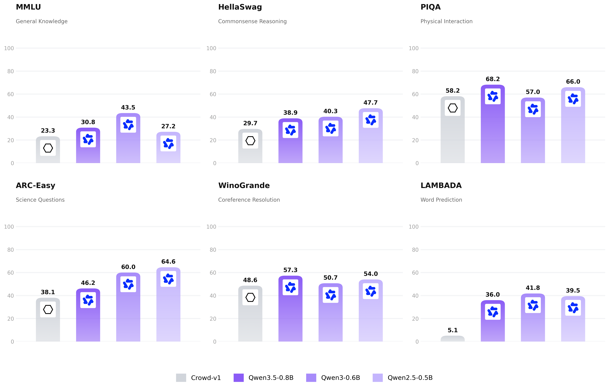

<p align="center">
  <a href="https://crowdgpt.net">
    <picture>
      <source media="(prefers-color-scheme: dark)" srcset="https://raw.githubusercontent.com/Vxtzq/CrowdGPT/main/docs/logo-dark2.png">
      <source media="(prefers-color-scheme: light)" srcset="https://raw.githubusercontent.com/Vxtzq/CrowdGPT/main/docs/logo-light2.png">
      
    </picture>
  </a>
</p>

<p align="center">
  <a href="https://crowdgpt.net">Website</a> ·
  <a href="https://discord.gg/2Shwqj3Xpx">Discord</a> ·
  <a href="./docs/ARCHITECTURE.md">Architecture</a> ·
  <a href="./docs/DATA.md">Training Data</a> ·
  <a href="https://github.com/Vxtzq/CrowdEval">Benchmarks</a>
</p>

<p align="center">
  
  
  
  <a href="https://discord.gg/2Shwqj3Xpx"></a>
  
</p>

<p align="center">
  <strong>The best 0$ AI.</strong>
</p>

# ℹ️ CrowdGPT v3.5 changelog ℹ️
## Crowd-v1.5 training run started 🥳
Train as much as you want.
- Five training paradigms, multi-token prediction, and two
  ways to send less over the wire. Everything below is **opt-in** - with no flags
  and no environment variables the client behaves exactly as it did in v1, so a
  v1.5 coordinator still serves v1 volunteers.
  
## Crowd-Mobile is in development
- More details soon

# Crowd-v1 Benchmarks
<p align="center">
  <a href="https://crowdgpt.net">
    <picture>
      
    </picture>
  </a>
</p>

**Disclaimer: This does not mean Crowd-v1 is an intelligent model. It just means it is good at general english** (these benchmarks are generally not hard)

### Choosing a training rule

`--paradigm` (or `CROWDGPT_PARADIGM`) selects how a round is trained and what is
uploaded. Unset means the stock backprop path.

| paradigm | what a volunteer trains | extra switches |
|---|---|---|
| `backprop` | the whole model, ordinary CE | — |
| `solo` | its module, through a local auxiliary head | `CROWDGPT_SOLO_MODULES` (default 2) |
| `relora` | low-rank adapters only, folded into the weight slice on upload | `CROWDGPT_RELORA_RANK` (default 8) |
| `dust` | a random-direction ensemble estimate (no gradients) | `CROWDGPT_DUST_POPULATION`, `CROWDGPT_DUST_SIGMA` |
| `mosaic` | one contiguous slice, aggregated by the server | `CROWDGPT_MOSAIC_SLICES`, `CROWDGPT_MOSAIC_LOCAL_STEPS` |

The upload is the server's flat whole-model layout under every paradigm, so the
coordinator does not need to know which rule a volunteer used. Measured
trade-offs, including which paradigms are *not* worth deploying, are in
`research/V2_PARADIGMS.md`, `research/V2_SCALE_306M.md` and `research/V2_COMPAT.md`.

### Sending less

Two independent knobs, both off by default:

- **Engram rows.** Only the rows carrying `CROWDGPT_ENGRAM_DELTA_MASS` (default
  0.995) of the update mass are uploaded, capped at
  `CROWDGPT_ENGRAM_DELTA_MAX_FRAC` (default 0.10) of the table.
- **Delta codec.** `CROWDGPT_DELTA_CODEC=sparse` sends the top
  `CROWDGPT_SPARSE_FRAC` (default 0.02) of coordinates by magnitude with error
  feedback on the residual (`CROWDGPT_SPARSE_FEEDBACK`, default on); the server
  reconstructs and scatters them (`SPK1` blocks, declared block length). `ngd1`
  is the existing 1-bit sign codec. Measured cost and fidelity per setting are in
  `research/V2_TRANSFER.md` — it is a bandwidth knob with a real fidelity price,
  and **low-rank is the better direction** at equal bytes (0.23 vs 0.94 relative
  error at 4.8 MB), which is why the dense default stays.

### Multi-token prediction

`CROWDGPT_MTP_TOKENS=4` (and optionally `CROWDGPT_MTP_WEIGHT`, default 0.2) adds
prediction heads for the next 4 tokens on top of the next-token loss. The
projections are identity-initialised, live only on the volunteer, and never reach
the wire. Backprop path only — a MOSAIC or SOLO slice has no readout of its own.

### Coordinator side (CrowdGPT-Server)

- `CROWDGPT_OUTER_MOMENTUM` — DiLoCo's outer step (default 0.0 = plain FedAvg).
- `CROWDGPT_ANCHOR_EVERY` + `CROWDGPT_ANCHOR_FACTORY=module:callable` — one
  full-model step on the server every N rounds. This is the only change that beat
  backprop at an equal round budget (306 M: 5.5941 vs 5.7631); leave it off in a
  token-bound deployment.
- The objective cross-check judges submissions on **paired per-window deltas** and
  refuses to pretend when it cannot measure: `/fl/round_status` reports
  `objectiveGate` with levels `unmeasured` / `degraded` / `ok`, and an unmeasured
  gate logs an error every round instead of silently accepting everything.

  
### Pre-flight a coordinator before a real round

`tools/rocm_client_push.py --url <coordinator> --token <token>` syncs the current
client to the ROCm test box, runs `--doctor`, then `--dry-run` — which exercises
auth and `GET /fl/task?skip_weights=true` and returns before any training or
upload, so exit 0 means a real round will get that far. (Bulk file transfer goes
over `scp`, not the shell helper: an inlined client is ~633 KB and exceeds the
~128 KB per-argument ceiling.)

First real round stays conservative: `--rounds 1 --paradigm backprop
--no-tokenizer --no-update` with **dense** deltas, because a coordinator built
before this branch has no `SPK1` sparse decoder. Then repeat the same round count
with `--paradigm mosaic` to compare.

## What is CrowdGPT?

CrowdGPT is a **project for training arbitrary big LLMs** using volunteered compute.

Instead of one datacenter doing all the work, CrowdGPT distributes training across participating machines.

**All of this working without money, API keys or any centralized GPU clusters.**

### How it works

1. The client asks the server for a task and is placed in a pool of 3 volunteers with compatible hardware.
2. It downloads the current weights from Hugging Face and trains on its shard of the dataset. All members of a pool get the same shard, seed and step count.
3. It uploads the weight delta. The server compares the 3 deltas of each pool, drops outliers, and merges the rest into the global model at the end of the round.
4. The new weights are published to [Vxtzq/Crowd-v1](https://huggingface.co/Vxtzq/Crowd-v1) and the next round starts.

The current model, Crowd-v1, is a 658M-parameter decoder (24 layers, 2048-token context, Qwen3 tokenizer) with an engram lookup table. The client runs no code from the server: it only receives weights and data. More in [ARCHITECTURE.md](./docs/ARCHITECTURE.md).

## 💻 Supported hardware

| Hardware | Backend | Notes |
|---|---|---|
| NVIDIA | CUDA | GTX 10xx and older need the cu126 PyTorch build. 8-bit optimizer via `bitsandbytes` |
| AMD | ROCm or DirectML | ROCm on Linux. On Windows, ROCm for supported GPUs and DirectML for the rest |
| Intel Arc | XPU | |
| Apple Silicon | MPS | |
| Anything else | CPU | Works, but slow |

The installer detects the hardware and installs the matching PyTorch build. Small GPUs work too: layers that don't fit in VRAM are kept in RAM and streamed in. Training the engram table adds about 1.4 GB of RAM (`CROWDGPT_ENGRAM=0` turns it off).

## ⚡ Quick installation (one command)

For Linux/MacOS

```bash
curl -sSL https://raw.githubusercontent.com/Vxtzq/CrowdGPT/main/install.sh | bash
```

For Windows

```
cmd /c "curl.exe -fsSL -o install.bat https://raw.githubusercontent.com/Vxtzq/CrowdGPT/main/install.bat && install.bat"
```

### 🐳 Docker (Linux — NVIDIA, AMD ROCm, Intel Arc, CPU)

```bash
git clone https://github.com/Vxtzq/CrowdGPT.git
cd CrowdGPT
./docker/run.sh auto build
./docker/run.sh auto up -d
./docker/run.sh auto logs -f
```

`./docker/run.sh` auto-detects NVIDIA CUDA, AMD ROCm, Intel XPU, or CPU and persists checkpoints and downloaded weights in a `/data` volume across image rebuilds. See [DOCKER.md](./DOCKER.md) for account configuration, non-toolkit NVIDIA hosts, and backend overrides.


## ▶️ Running

The installer adds a `crowdgpt` command and a desktop / Start Menu shortcut. The app opens a window by default.

On a server or over SSH, run without a window:

```bash
crowdgpt --headless                      # reuses the login saved by the app
export CROWDGPT_PASSWORD= "<your password>"
crowdgpt --headless --user NAME
crowdgpt --headless --anon               # train without an account
crowdgpt --headless --rounds 5           # stop after 5 rounds
```

Create an account without opening the desktop app:

```bash
crowdgpt --register --user NAME --email you@example.com
# prompts for the password without echoing it

crowdgpt --register --user NAME --email you@example.com --password '...'
```

Prefer the hidden prompt. Passing `--password` is intended for automation and may
leave the value in shell history or the process list. Registration saves the session
token in `checkpoints/auth_token.json`, so the next `crowdgpt --headless` run can
reuse it. Registration exits without training.

Log in to an existing account and save the session, again without the desktop app:

```bash
crowdgpt --login --user NAME
# prompts for the password without echoing it
```

`--login` also accepts `CROWDGPT_PASSWORD` or `--password`, with the same caveat as above. It saves the session in `checkpoints/auth_token.json` and exits without training.

### Diagnostics

Before reporting a launch or training problem, run the read-only environment check:

```bash
crowdgpt --doctor
crowdgpt --doctor --json > doctor.json
```

It checks the client version and paths, OS/Python/architecture, CPU/RAM/disk and
checkpoint writability, Python package versions, available and requested backends,
GPU names/VRAM/architecture compatibility, the memory/batch/optimizer plan, whether a
saved session is present, the signed update manifest, Hugging Face and coordinator
reachability, and a tiny device matmul. Tokens and passwords are never printed.
`--doctor` does not apply updates or start training. It exits `1` only for blocking
failures; warnings are reported without failing the command. `--server`, `--backend`,
and `--vram-gb` are honored for the checks.
`crowdgpt --help` lists all options. A few settings can also be set through environment variables:

| Variable | Description |
|---|---|
| `CROWDGPT_TOKEN` / `CROWDGPT_PASSWORD` | Credentials for headless runs |
| `CROWDGPT_EMAIL` | Email for `--register` |
| `CROWDGPT_VRAM_GB` | Same as `--vram-gb` |
| `CROWDGPT_ENGRAM=0` | Don't train the engram table (same as `--no-engram`) |
| `CROWDGPT_CLIENT_OPTIM` | Inner optimizer: `auto` (default), `adamw`, `sgd`. `auto` picks SGD+Nesterov when the server asks for ≤ 2 optimizer steps per round, because a cold AdamW's first step is `sign(g)` per coordinate and averaging signs across shards is a coin flip |
| `CROWDGPT_CLIENT_LR` | Inner learning rate. Unset = derived from the server's optimizer-step budget |
| `CROWDGPT_CLIENT_LR_RULE` | `linear` (default), `sqrt` or `none`: how the lr scales with the larger batch a shorter round implies |
| `CROWDGPT_CLIENT_LR_REF_STEPS` | `16`: the optimizer steps per round the base lr (`CROWDGPT_CLIENT_BASE_LR`, default `1e-4`) was tuned at |
| — | Micro-batches per optimizer step come from the task payload's `targetAccumSteps` (32 = v1's batch); the client uses it verbatim and reports the actual optimizer-step count it ran |
| `CROWDGPT_CLIENT_ENGRAM_LR` | Engram learning rate, default `1e-4`. Independent of the base lr |
| `CROWDGPT_CLIENT_GRAD_CLIP` | Gradient-clip norm for the base model, default `1.0` |

A round trains the same number of tokens whatever the optimizer-step budget is: the server
sends `crossCheck.targetOptimizerSteps`, and the client groups its 500 micro-steps into that
many optimizer steps (`accum = ceil(500 / targetOptimizerSteps)`) instead of deriving `accum`
from the batch size. The delta then reports `optimizerSteps` and `accum` so the coordinator can
normalise by the steps actually taken.

The headless client opens a full-screen terminal dashboard on a TTY. It shows the same
training metrics as the desktop app: round, step progress, loss graph, tokens/sec, ETA,
download/upload state, recent model predictions, and an activity log. Use `--no-tui`
for plain log lines, or `--tui` to force the dashboard.

While the dashboard is running:

- `s` stops training at the next safe step; press `s` again to start a new round.
- `q` or `Ctrl+C` quits.
- The layout reflows when the terminal is resized. `s` and `q` are ordinary characters,
  so they do not conflict with `tmux`/`screen` prefix bindings.
- The dashboard needs a normal UTF-8 terminal. It falls back to plain logs on
  `TERM=dumb`/`unknown` and on legacy Windows consoles without VT support; use
  `--tui` to override the auto-fallback. Modern Windows Terminal is the
  recommended Windows host.

### Updates

The client checks for updates on start and between rounds. An update is only installed if its manifest is signed with the maintainer's key, so a compromised repository or account can't push code to clients. `--no-update` skips the check. Details in [SECURITY.md](./SECURITY.md).

When releasing a client change, bump `CLIENT_VERSION` in `client.py` to a strictly newer value and re-sign `docs/version.txt` (the client fetches `docs/version.txt.sig`). Clients ignore a version they already run, so re-signing the same version will not reach anyone.


## 🔧 Troubleshooting

- **Stuck on "Pool matchmaking 1/3 (waiting for peers)"**: each round is trained by a pool of 3 clients with compatible hardware and precision. When few people are online, waiting is normal.
- **GPU not used**: check the `Backend:` line in the log. GTX 10xx and older need the cu126 PyTorch build (see `requirements_cuda.txt`). `--backend` forces a specific one.
- **Out of memory**: `--vram-gb` limits how much VRAM the client plans to use. Layers that don't fit are streamed from RAM.
- **Files**: login, settings and downloaded weights are in `checkpoints/` next to `client.py` (`~/.local/share/crowdgpt` on Linux, `~/Library/Application Support/CrowdGPT` on macOS, `%LOCALAPPDATA%\CrowdGPT` on Windows).


## ⏳ Legacy installation (deprecated)

```bash
git clone https://github.com/Vxtzq/CrowdGPT.git
cd CrowdGPT
```

Install the dependencies for your hardware:

```bash
# NVIDIA
pip install -r requirements_cuda.txt

# AMD
pip install -r requirements_rocm.txt

# Windows / DirectML
pip install -r requirements_directml.txt

# CPU / Apple Silicon
pip install -r requirements.txt
```

Then:

```bash
python client.py
```

---


## 🧠 Contribute

- **Training data** is curated through pull requests. See [`docs/DATA.md`](./docs/DATA.md).
- **Code**: pull requests are welcome. CI checks that the Python files compile and that `install.sh` parses.
- **Bugs**: open an issue with the bug report template, and include the client version and the log.
- **Server**: the coordinator lives in [Vxtzq/CrowdGPT-Server](https://github.com/Vxtzq/CrowdGPT-Server).

### CrowdGPT power-trainers applications are open!! 

Power-trainers can train by themselves, without any checks. Reach a trust-score of 1, and you're eligible.

## 📄 License

GPL-3.0. See [LICENSE](./LICENSE).

---

<p align="center">
  <a href="https://crowdgpt.net"><strong>crowdgpt.net</strong></a>
  ·
  <a href="./docs/ARCHITECTURE.md">Architecture</a>
  ·
  <a href="./docs/DATA.md">Data</a>
</p>
